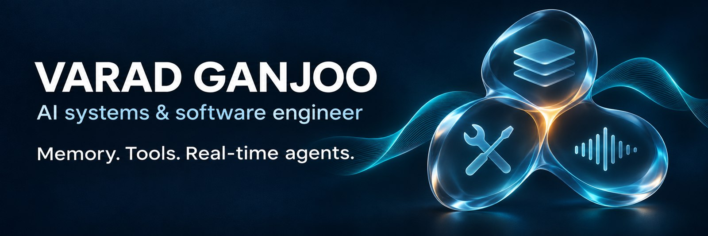
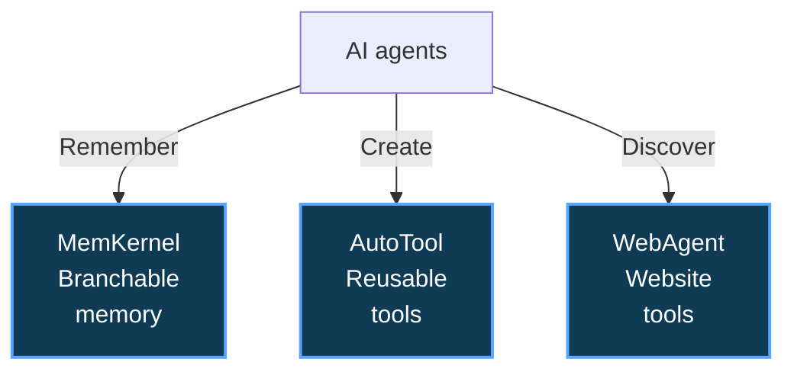

# Hi, I'm Varad 👋

**AI Systems & Software Engineer**

I build tools that help agents remember, act, and work with people. My projects span developer infrastructure, voice interfaces, and applied AI.

[LinkedIn](https://www.linkedin.com/in/varad-ganjoo-3137631b2/) · [Email](mailto:varadganjoo@gmail.com) · [All public repositories](https://github.com/varadganjoo?tab=repositories&type=public)

[Latest build](#-latest-build-local-omni-agent) · [Agent infrastructure](#-featured-projects) · [Applied AI](#️-applied-ai-systems) · [Technical stack](#️-technical-stack)

## 🎧 Latest Build: Local Omni Agent

**Talk to it. Show it your world. Keep inference on your machine.**

My experimental voice-and-vision agent brings **LFM3-Omni-2B, llama.cpp, and Pipecat** together in a browser interface.

- **Voice + vision:** microphone audio and recent webcam frames inform each reply.
- **Natural interruption:** speak over a response to cancel inference and stop playback.
- **Useful local actions:** save Markdown notes and retain facts or preferences through two validated tools.
- **Local inference:** conversation and speech generation run on your own machine after setup.

Media streams continuously; the model responds at turn boundaries. The supported setup is **Windows with an NVIDIA GPU**. This is a working experiment, not a production assistant.

[Explore the project](https://github.com/varadganjoo/lfm3-omni-realtime-agent) · [Quick start](https://github.com/varadganjoo/lfm3-omni-realtime-agent#quick-start) · [Architecture](https://github.com/varadganjoo/lfm3-omni-realtime-agent/blob/main/docs/live-experiment.md) · [Verification](https://github.com/varadganjoo/lfm3-omni-realtime-agent/blob/main/docs/live-verification.md)

📸 See the voice & vision interface

<picture>
  <source media="(prefers-color-scheme: dark)" srcset="https://raw.githubusercontent.com/varadganjoo/lfm3-omni-realtime-agent/main/docs/assets/interface-dark.png">
  
</picture>

---

## 🧩 Featured Projects

Three independent libraries for the infrastructure around an agent:

### 🧠 [MemKernel](https://github.com/varadganjoo/MemKernel)

Shared local memory for coding agents: persistent decisions, investigation branches, memory rollback, and token-budgeted snapshots over an append-only SQLite event log.

Local agents coordinate through leases and notices. Signed notices can travel through a synced folder; direct memory sync between machines is still in development.

[Python package](https://pypi.org/project/memkernel-mcp/) · [Design & benchmarks](https://github.com/varadganjoo/MemKernel/blob/main/docs/whitepaper.md)

### 🛠️ [AutoTool](https://github.com/varadganjoo/Autotool)

An MCP tool layer that lets agents create, verify, and reuse Python tools without restarting the server. Tools run in separate processes, with per-tool credential declarations, consent, host allowlists, and output redaction.

[Python package](https://pypi.org/project/autotool-mcp/) · [Design & evaluation](https://github.com/varadganjoo/Autotool/blob/main/paper/autotool.md)

### 🌐 [WebAgent Protocol](https://github.com/varadganjoo/WebAgent-Protocol)

A Python SDK and proposed MCP extension for discovering tools published by websites. Signed manifests and responses support verification, with confirmation hooks, rate limits, replay protection, and bounded multi-turn interactions.

[Python package](https://pypi.org/project/webagent-protocol/) · [MCP extension proposal](https://github.com/varadganjoo/WebAgent-Protocol/blob/main/docs/mcp_extension.md)

## 🎙️ Applied AI Systems

### [Airline Voice Customer Assistant](https://github.com/varadganjoo/airline-voice-customer-assistant)

A voice service demo where Gemini handles the conversation and Python owns booking verification, quotes, approvals, and database changes. Includes durable receipts, recovery paths, and trace-linked operations views.

**Engineering evaluation with synthetic data.** Airline inventory, identity delivery, payments, and telephone transfers are simulated.

[Architecture](https://github.com/varadganjoo/airline-voice-customer-assistant/blob/main/docs/enterprise.md) · [Recorded browser evaluation](https://github.com/varadganjoo/airline-voice-customer-assistant/blob/main/docs/live-browser-test.md)

| Project | What I built |
| --- | --- |
| [CareFlow Clinical Agent](https://github.com/varadganjoo/careflow-clinical-agent) · [Demo](https://careflow-clinical-agent.vercel.app) | Clinical documentation with de-identification, code-level safety checks, and physician sign-off. Fictional patients; not clinically validated. |
| [Apex-Alpha](https://github.com/varadganjoo/apex-alpha) · [Demo](https://apex-alpha-tan.vercel.app) | Research terminal combining market data, Monte Carlo simulations, filing-grounded agent debate, and human review of staged orders. |
| [Aegis SRE](https://github.com/varadganjoo/aegis-sre) | Incident-response simulation with action validation, blast-radius checks, and operator feedback recorded as reusable rules. |

📸 See CareFlow, Apex-Alpha, and Aegis in action

### CareFlow: an editable SOAP note

### Apex-Alpha: Monte Carlo forecasts

### Aegis SRE: a stored incident-response skill

## 🌱 Experiments & Earlier Work

### [Sproutfile](https://github.com/varadganjoo/sproutfile)

An experiment in portable documents that carry their sources, update recipes, and readable snapshots. A local runtime refreshes affected blocks; another agent can continue unfinished prose.

The current demo uses local files and deterministic recipes, with no model or network calls.

[Before / after demo](https://varadganjoo.github.io/sproutfile/) · [Agent continuation protocol](https://github.com/varadganjoo/sproutfile/blob/main/docs/AGENT_PROTOCOL.md)

- **[Baby LLM](https://github.com/varadganjoo/baby-llm):** Incremental n-gram memory, adaptive embeddings, and a PyTorch GRU with attention. A language-learning experiment.
- **[Voice & Vision Assistant](https://github.com/varadganjoo/realtime-voice-and-vision-assistant):** Windows voice assistant with weather, search, screen/webcam input, and approval gates for sensitive actions.
- **[Real-Time Speech Transcription](https://github.com/varadganjoo/Real-Time-Speech-Transcription):** Speech detection, Whisper transcription, and grammar refinement in a desktop interface.

## 🧪 [Enterprise AI Systems](https://github.com/varadganjoo/enterprise-ai-systems)

Nine runnable reference applications exploring retrieval, document processing, agent workflows, and model infrastructure. Each has its own FastAPI application, interface, tests, and evaluation scorecards.

Explore the nine reference applications

| Focus | Applications |
| --- | --- |
| Retrieval & evidence | [Cited Knowledge Agent](https://github.com/varadganjoo/enterprise-ai-systems/tree/main/01-cited-knowledge-agent), [Claim Auditor](https://github.com/varadganjoo/enterprise-ai-systems/tree/main/07-claim-auditor), [Multi-Hop Brief](https://github.com/varadganjoo/enterprise-ai-systems/tree/main/09-multi-hop-brief) |
| Operations & approvals | [Document Extraction](https://github.com/varadganjoo/enterprise-ai-systems/tree/main/02-document-extraction), [Operator Agent](https://github.com/varadganjoo/enterprise-ai-systems/tree/main/03-operator-agent), [Case Workflow](https://github.com/varadganjoo/enterprise-ai-systems/tree/main/08-case-workflow) |
| Infrastructure | [Analytics Copilot](https://github.com/varadganjoo/enterprise-ai-systems/tree/main/04-analytics-copilot), [Model Router](https://github.com/varadganjoo/enterprise-ai-systems/tree/main/05-model-router), [Memory Service](https://github.com/varadganjoo/enterprise-ai-systems/tree/main/06-memory-service) |

## ⚙️ Technical Stack

**Languages:** Python, TypeScript, SQL  
**Agent systems:** MCP, LangGraph, LangChain, Pydantic, PyTorch, llama.cpp, Pipecat  
**Backend & data:** FastAPI, Node.js, SQLite, PostgreSQL, Redis  
**Interfaces:** React, Tailwind CSS, Chart.js, desktop audio  
**Delivery:** pytest, reproducible evaluations, package releases, GitHub Actions

I keep state explicit, validate model proposals in code, and test failure paths alongside successful ones.
